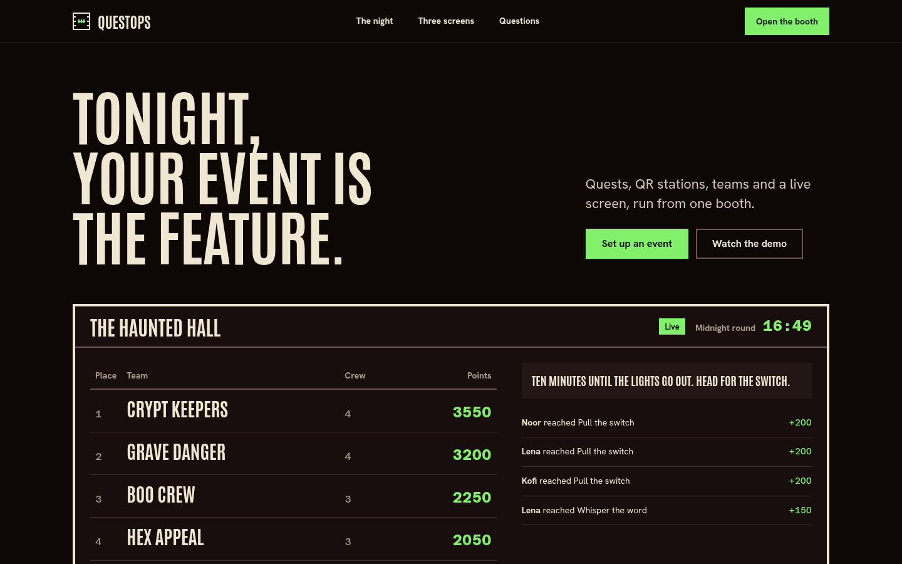
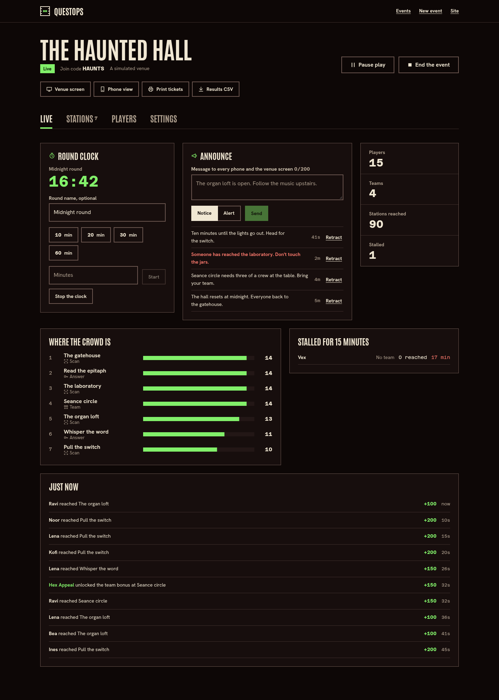
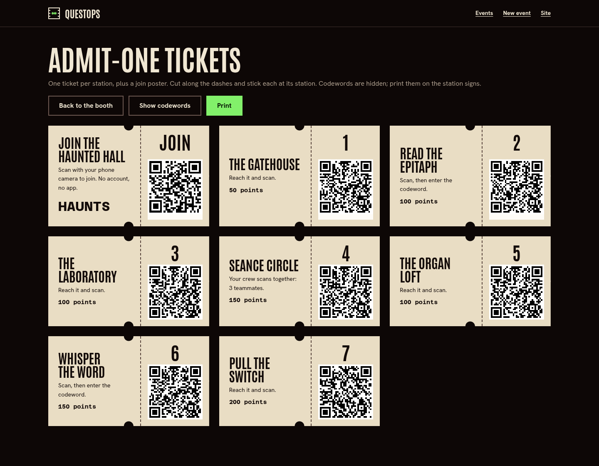
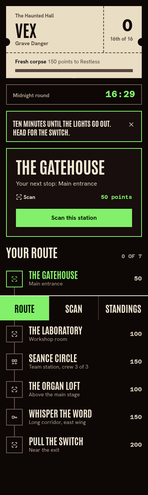
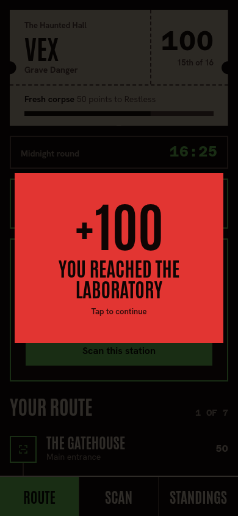
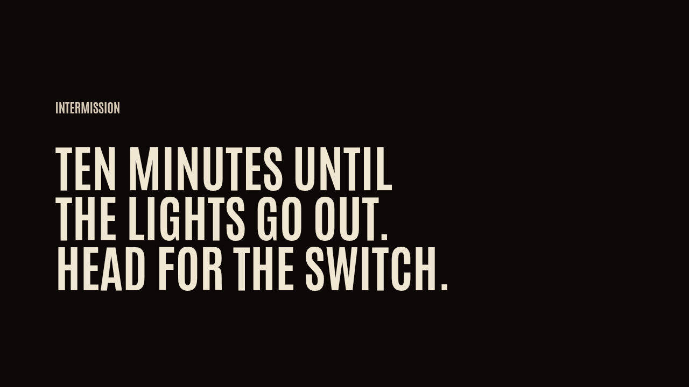
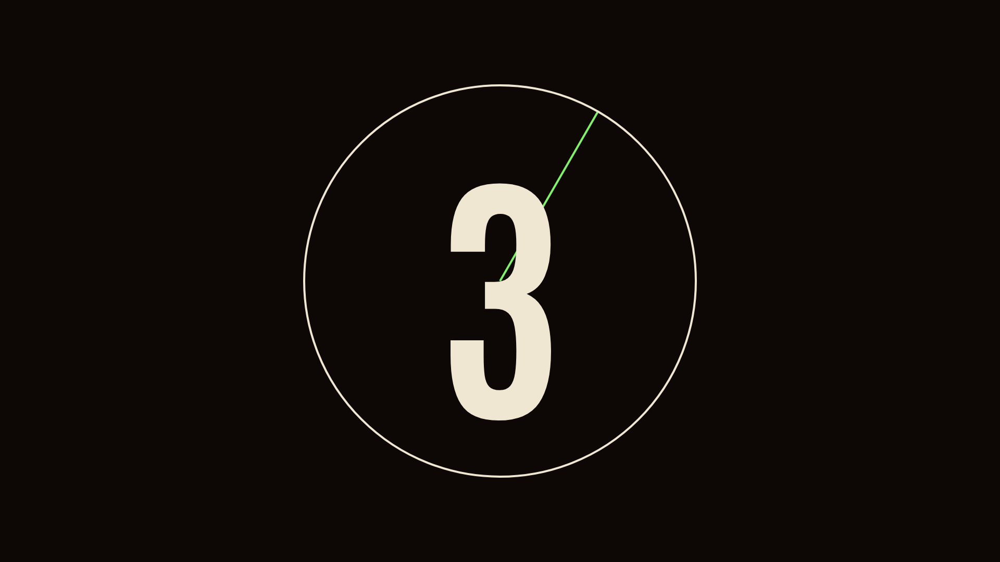
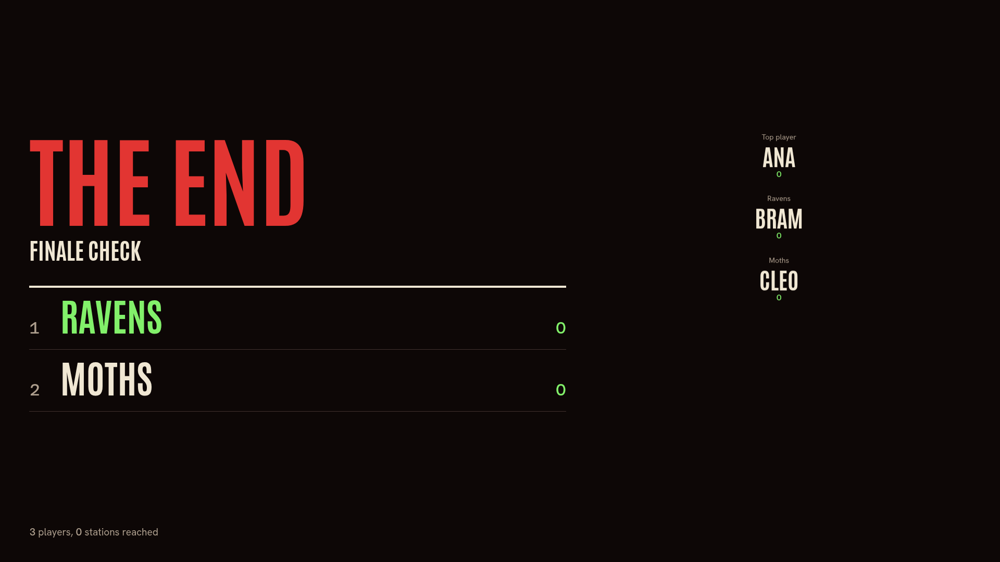

# QuestOps

**Tonight, your event is the feature.** QuestOps runs a live event as a game. You describe the night and AI drafts a storyline and a route of stations. You print each station as an admit-one ticket with a QR code. Players walk the venue scanning tickets on their phones while a venue screen bills the teams live. You steer it all from one console.

Built with [Kiro](https://kiro.dev) for **Kiroween 2026**, Frankenstein category. QuestOps stitches four parts that were never meant to fit into one creature: event software, multiplayer game mechanics, QR check-ins and generative AI.



## Try it in one minute

```bash
npm install
npm run dev            # http://localhost:3000
```

The first visit creates **The Haunted Hall** (join code `HAUNTS`), a Halloween event whose players are simulated. While anyone is watching it, simulated players scan stations, crews unlock bonuses and the organizer side posts announcements. When everyone reaches the last station it resets and plays again.

| Open | What you see |
| --- | --- |
| `/` | The landing page, with the demo playing live |
| `/board/HAUNTS` | The venue screen. Put it on a projector |
| `/play/HAUNTS` | Join as a player on your phone |
| `/console` | The organizer console ("the booth") |
| `/console/new` | Guided setup: details, AI brief, review, create |

To test on a phone, open the console at your laptop's network address (for example `http://192.168.1.20:3000`). The printed QR codes then point somewhere your phone can reach. You can also set `PUBLIC_ORIGIN` in `.env.local`.

## What it does

### The booth (organizer console)



- **Guided setup.** Name the event, brief the AI (theme, size, difficulty, team stations), then review and edit every drafted station before anything is saved.
- **Live tab.** It holds:
  - The round clock: every phone and the venue screen count down together, corrected for clock skew.
  - Announcements to every phone and the venue screen.
  - Pause and resume play, and going live or ending the event.
  - How many players have reached each station, with empty stations flagged.
  - Players with no scan for 15 minutes.
  - The live feed.
- **Players tab.** Search players, give or take points with a reason (shown in the feed), and remove a player.
- **Stations tab.** Reorder, edit and delete stations, and draft more with AI.
- **Outputs.** The venue screen, the phone view, printable admit-one tickets and a results CSV.



### The ticket (player phone)

<p>


</p>

- Join with a name and an optional team. No account, no app.
- A ticket header shows score, rank, level (from *Fresh corpse* to *Lich*) and points to the next level.
- The next station is pinned at the top. Tap any station for its brief, where to find it and what it is worth.
- Scan in the page, or with the phone's own camera. Each ticket's QR opens the game and counts the station. You can also type the code.
- A check-in slams in as a title card, with a buzz where the phone supports it. Players see when they are first to arrive and when their team unlocks a bonus.
- Announcements, the round clock and standings arrive live over the player's own stream.
- When the event ends, players get a recap card they can share.

### The screen (venue)



- Teams, players, the live feed, the round clock, the join code and the join QR, sized to read from the back of a hall.
- Spotlights for first arrivals and team bonuses, full-screen intermission cards for announcements, and a flash when a score changes.
- A 3-2-1 film leader when the event goes live. The end credits name the top three and roll the full standings.

<p>


</p>

### Station types

| Type | The player | Scoring |
| --- | --- | --- |
| Scan | reaches the station and scans it | the station's points |
| Answer | scans, then enters the codeword printed on the station sign | the station's points. Answers never leave the server, and guesses are rate-limited |
| Team | scans with their crew | each scan scores, and the team earns a bonus once enough teammates have scanned |

## How it is built

- **Next.js App Router, React 19, TypeScript (strict).** Pages render on the server with real data, so nothing waits on JavaScript before it shows.
- **SQLite** (`better-sqlite3`, WAL mode) in `data/questops.db`. Every write that changes what a screen shows bumps `events.version` in the same transaction. New columns migrate in place.
- **One live loop per event** (`lib/bus.ts`). It reads one integer every 400 ms while anyone is watching, builds the snapshot once per version and pushes it to every screen over Server-Sent Events. A burst of scans becomes one broadcast. The loop stops when the last screen disconnects. Tested with 60 open connections: one loop, and every client got every update.
- **AI** (`lib/ai.ts`) calls Groq, Anthropic or OpenAI, whichever key is set first in that order. Groq runs `openai/gpt-oss-120b` with a strict JSON schema, so replies come back in the right shape. Model output is validated before anyone sees it. Without a key, or if the provider fails, built-in haunted and classic packs draft the route and the console says so.
- **Plain CSS with design tokens** (`app/tokens.css`). The fonts are Antonio, Hanken Grotesk and Azeret Mono, self-hosted through Fontsource.

### Configuration

Copy `.env.example` to `.env.local`.

| Variable | Purpose |
| --- | --- |
| `CONSOLE_PASSCODE` | Organizer passcode. Unset: the console is open in development and disabled in production |
| `GROQ_API_KEY` / `GROQ_MODEL` | Use Groq for drafting (free tier at [console.groq.com](https://console.groq.com/keys)). Model defaults to `openai/gpt-oss-120b` |
| `ANTHROPIC_API_KEY` / `ANTHROPIC_MODEL` | Use Claude for drafting |
| `OPENAI_API_KEY` / `OPENAI_MODEL` | Use OpenAI for drafting |
| `PUBLIC_ORIGIN` | Fixed origin printed into QR codes |

### Security

- Organizer cookies are HMAC-signed, httpOnly and SameSite=Lax, and the passcode check is timing-safe.
- Every write endpoint refuses cross-site requests.
- Inputs are cleaned at the boundary, and all SQL is parameterised.
- Codewords stay server-side, and answer guesses are rate-limited.
- The CSV export neutralises cells that would run as spreadsheet formulas.

### Limits

- It runs as one server process. Several instances would need the bus moved to Postgres `LISTEN/NOTIFY` or Redis; the subscribe interface stays the same.
- There are no organizer accounts or roles beyond the passcode, and no payments or ticketing.
- In-page QR scanning needs a browser with `BarcodeDetector` (Chrome on Android). Elsewhere the phone camera opens the same link.
- Load has been tested to 60 connections on a laptop, not to a full venue. Load-test before a large crowd.

## How Kiro was used

The `.kiro/` folder is committed and is part of the submission.

- **Spec-driven development.** `.kiro/specs/live-ops/` holds the requirements (10 user stories with acceptance criteria), the design (architecture, data model, interfaces, the demo simulator) and the task plan for the live-operations phase. Tasks were ticked only after they were verified by the API test script, the load test or a screenshot.
- **Steering.** `.kiro/steering/product.md` (people, terms, rules that always hold), `tech.md` (stack and conventions, such as "never add a per-connection database poll") and `design.md` (the visual system, loaded only for UI files).
- **Hooks.** `.kiro/hooks/` runs the strict type check at the end of every agent turn and the Hallmark design linter whenever the stylesheet is saved. An agent hook keeps the spec's task list honest.
- **Skills.** The visual world came from the Impeccable direction process (a dealt direction, approved by a person) and was checked with the Hallmark linter and a fresh-context finish review.

## Licence

[MIT](LICENSE)
